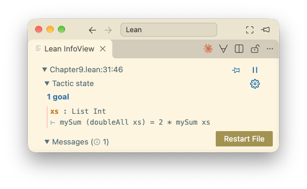
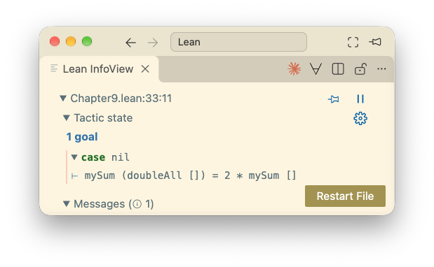
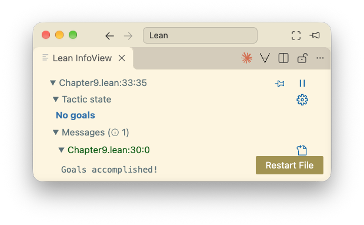
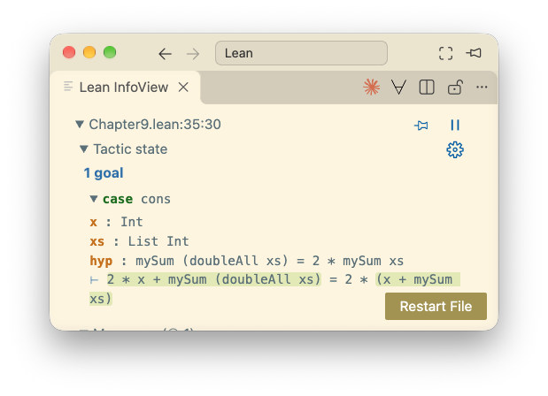
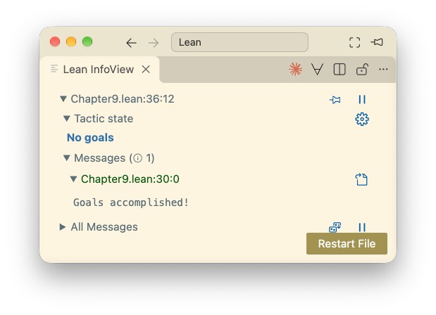

# Mechanical proof for Haskell programs: a companion in Lean

It is no accident that definitions of functions in Haskell look like equations. Function definitions in Haskell can be read as statements in logic, and properties of functions follow logically from these definitions. _Haskell: the Craft of Functional Programming_ takes a informal, but mathematical, approach to showing this in Chapter 9 (functions over lists), Chapter 11 (higher-order functions), Chapter 14 (algebraic data types) and Chapter 17 (lazy programs). 

While there is little doubt that these proofs are valid, it is possible to be more rigorous, and to formalise the propositions and proofs in a _mechanised proof assistant_ such as [Lean](https://lean-lang.org) or [Rocq](https://rocq-prover.org), which would make sure that the proofs were valid, just as a compiler of a programming language checks the validity of a program in the language. In this companion we show how to take definitions from Haskell into Lean, and then how to mechanise results about them in the logic of Lean.

## Translating definitions to Lean

Lean and Haskell are different languages and systems with different properties and behaviour, and so there could be problems in using Lean for this work. In fact, the definitions and results in Chapters 9, 11, and 14 carry over to Lean directly. This is in part because the formulation in the book is clear about the theorems applying to _finite_ data. This is also the case for the _finite partial_ data in the first part of Chapter 17, but the _infinite_ data in the latter half of that chapter does not have a direct equivalent in Lean (it can, however, be represented (or _modelled_) there with more effort). 

Functions in Lean are required to be total – to be defined on their whole domain, omitting no cases, and to _terminate_ on all inputs. Most of the definitions we give can be seen to terminate structurally: that is, it is clear how any recursive calls made by a function are to structurally simpler arguments. In cases where this is not explicit a more complicated argument is needed to make it evident to the system that the definition indeed terminates in all cases.

Evaluation in Lean is strict: arguments to function applications are evaluated before the body of the function. By contrast, Haskell evaluation is lazy: evaluation begins with the function body and arguments are only evaluated when needed, if at all. 
Since all the Haskell functions we consider here are _pure_ in having no side-effects, a different evaluation order makes no difference to the final value of a function application, and so the translation of functions into Lean is faithful.

Lean contains the equivalent of algebraic types, including a built-in type of list, and so translation there is straightforward. However, `Nat` and `Int` are different types; subtraction on `Nat` stops at 0, so `3 - 5 = 0`, and patterns on `Nat` use `n + 1` where Haskell definitions often use `n - 1` in the body. There is no simple equivalent of machine floating-point, `Float`, so definitions using that type need to be translated in a different way. Strings in Lean are a distinct type, rather than being a synonym for lists of `Char`; they can be converted to `List Char` using the `toList` function.

Finally, we made a couple of design decisions in making the translation. First, many of the functions are redefined from scratch (`myMap`, `+++`, ...) rather than using Lean's own definitions, so that the proofs use the book's defining equations, not library lemmas that already prove the results. Secondly, the project doesn't use Mathlib, Lean's large mathematical library. While Mathlib would add many more lemmas and stronger automation, this keeps the project small and self-contained.


## Formalising proofs in Lean

While the definitions and theorems carry over, the style of the proofs is different. In the book we have shown the proofs in a _direct_ ‘equational’ style, typically rewriting an expression in a series of steps for a number of cases. Lean proofs are described _indirectly_ as the application of a series of _tactics_ to a proof goal; the tactics gradually reduce the goal to simpler goals, and ultimately prove those outright. 

What we see in the Lean code is a description of how to build a proof – like a _recipe_ – rather than the proof itself. This has the advantage that the recipe might be much shorter and high-level (or ‘strategic’), but it is at the potential cost of concealing the direct proof. This approach is common to other proof assistants such as Rocq; by contrast Agda proofs are in fact expressions in a functional language, but even those are not as immediately clear as proofs in the mathematical style of the book. 

## Our approach

If you're already familiar with Lean, then the Lean files LINK should be self-explanatory: they show the Lean versions of the code, theorems and proofs in the various chapters of the book. To check your understanding, you could try the exercises, LINK, which build on the examples given in the text.

IS THIS BELOW TRUE?

If you don't know Lean, this document aims to tell you enough about Lean so that you can understand the Lean files, chapter by chapter. There is abundant information about Lean online, and in particular [Functional Programming in Lean](https://lean-lang.org/functional_programming_in_lean/) is a textbook on Lean as a functional programming language, and [Mathematics in Lean](https://leanprover-community.github.io/mathematics_in_lean/mathematics_in_lean.pdf) is a course on formalising mathematics in the Lean interactive proof assistant.

ADD AN OVERVIEW TO WHAT FOLLOWS, SECTION BY SECTION

## A first example

The first example in the book covers lists of integers, and their sums. `mySum` sums the list, and `doubleAll` doubles every element in a list. Their definitions are

```lean
def mySum : List Int → Int
  | []      => 0                     -- (sum.1)
  | x :: xs => x + mySum xs          -- (sum.2)

def doubleAll : List Int → List Int
  | []      => []                    -- (doubleAll.1)
  | z :: zs => 2 * z :: doubleAll zs -- (doubleAll.2)
```
and it is easy to see the similarities and differences with Haskell syntax. Full details of Lean syntax for definitions are given in Appendix LINK.

How are these two functions related?

```lean
theorem sum_doubleAll (xs : List Int) :
    mySum (doubleAll xs) = 2 * mySum x
```
Informally, “summing a list all of whose elements is doubled gives the same result as doubling the sum of the original list”. Declaring a theorem is just like our earlier definitions: this theorem is called `sum_doubleAll`, and has the parameter `xs`. This means it applies to _all_ lists of integers, `xs`. The statement of the theorem follows the `:`, and is the _type_ expressing an equality between two expressions.  

- The fact this _is_ a definition is signalled by the definition operator `:=` which can be read as _‘is defined to be …’_.
- All definitions in Lean use this, except definitions by pattern matching (like those of `doubleAll` and `my Sum` above!)
- It is, in fact, the definition of a _function_ that proves the theorem for every `xs`, list of Integer; in other words it proves the result **for all** `xs`. 

This theorem is proved like this:

```lean
theorem sum_doubleAll (xs : List Int) :
    mySum (doubleAll xs) = 2 * mySum xs := by
  induction xs with
  | nil => simp [mySum, doubleAll]
  | cons x xs hyp =>
      simp [mySum, doubleAll]
      omega
```
There is quite a lot to understand in this code. First, it is a definition. What is defined by this?

- The keyword `by` signals that this definition is a sequence of _tactics_ that step-by-step break down – and solve – the original goal.
- In other words, what we see is the _recipe_ that we talked about in the introduction.
- At the top level we can see that the proof is by `induction` over the list `xs`.

But how should we understand the initial goal, and how it is solved by breaking it down into sub-goals that are themselves progressively broken down, and solved? 

We can only do this by loading the file into the Lean system, and interacting with it in the **Lean InfoView** window. This lets us see the state at each stage in the proof: the state will be a list of (named) hypotheses before the turnstile `⊢`, and following it the current goal.

- Immediately following `by`, we can see the hypothesis, or assumption that `xs : List Int` and the goal which is the theorem itself.

  

  This is broken down into two subgoals by `induxtion xs with`  

- Following `nil =>` we see the first subgoal: proving the theorem in the case of the empty list
  
  

- At the end of the same line, we see that this has been solved, by `simp`lifying the goal using the definitions of the two functions, which both give the result 0.

  

- Following `cons x xs hyp =>` we see three hypotheses: the names of values on which we're trying to prove the induction step, and the induction `hyp`othesis, which is named in the case too

  

- At the end of the `symp` line we see the goal has been simplified by using the definitions of the functions, but that we need some properties of arithmetic to make some progress.

  

- At the end of the proof, we see that `omega` has given us the needed arithmetic, and has also automatically applied the induction hypothesis too.

  


# NOTES

## Lean vs. Haskell


Lean does have `partial def` for functions it can't show terminate, but nothing can be proved about them.

What about laziness? It has two consequences.

First, function applications are evaluated in a different order: start evaluating the body, and only evaluate the arguments when computation requires it (and then only to the extent that allows computation to continue). Lean, like most languages, is strict: arguments are evaluated first.

Evaluation order matters less than it might, because of a property that is not a given for every language: values are independent of evaluation order (confluence, or Church–Rosser). If two orders of evaluation both give a value, it is the same value.
- In Lean every function is pure and total, so every order gives the same result. This is what makes equational reasoning sound: `rw` can replace equals by equals anywhere in a term, without asking when that subterm would be evaluated.
- In Haskell, which is pure but not total, evaluation order can change *whether* there is a value, but not *which* value. Lazy evaluation terminates whenever any order does (the standardization theorem); strict evaluation can loop where lazy evaluation succeeds, as with `const 17 undef`.
- Caveats in Haskell: `unsafePerformIO` makes evaluation order observable; and `seq` distinguishes `undefined` from `\x -> undefined x`, so eta-equivalence, and with it extensionality as stated in Chapter 11, holds only for defined functions. Lean's escape hatches (`unsafe`, `IO`, `implemented_by`) only affect compiled code run by `#eval`, never what can be proved.

Second, laziness removes the dichotomy evaluated/unevaluated, and this has the consequence that the types contain extra values: data structures can be partial or infinite, as well as undefined. Lean's `inductive` types contain only finite, fully defined values, so these require a different treatment in Lean: in Chapter 17, `PList` for finite and partial lists. (Infinite lists are a stream type, in Streams.lean, not covered here.)

## Syntax in Lean

Use of Greek and mathematical symbols. Input by means of shortcuts `\a` or `\alpha` etc. 

Insert or link to a reference table. 

## Definitions in Lean

This gives information about how to transliterate definitions from Haskell into Lean.

Could give a table of correspondences in syntax.

Particular points to note for value definitions. Give examples where necessary.
 - Definitions use `:=` rather than `=` which is the logical equality, and `==` which is Boolean equality.
 - `:=` is omitted in definitions by pattern matching over inductive types
 - In such definitions parameters are separated by commas (which would not be the case in Haskell).
 - Only the arguments after the colon are pattern-matched: in `def myMap (f : α → β) : List α → List β`, `f` is a fixed parameter, and the cases match on the list.
 - And case values follow `=>`.
 - Local definitions allowed too.
 - Types have to be declared. There is polymorphism and type classes. See examples.
 - Type parameters can be implicit.
 - DIY infix allowed, with a precedence and associativity, as in `infixr:65 " +++ " => myAppend`. Precedence matters, and can differ from Haskell's: in Lean `::` (precedence 67) binds more tightly than our `+++` (65), so `w :: xs +++ ys` means `(w :: xs) +++ ys`; in Haskell `:` and `++` are both `infixr 5`, so `w : xs ++ ys` means `w : (xs ++ ys)`. The two terms have the same value, but they are different terms, and a proof has to deal with the one actually written (see `filter_append` in AdditionalChapter14). `set_option pp.parens true` makes Lean print all the brackets.

Termination
- `termination_by` in the case of non-structural recursion, with `decreasing_by` to prove that each recursive call decreases the measure.
- Three levels, depending on where the arguments of the recursive calls come from:
  1. Structural recursion: each call is on a piece of the input, got by pattern matching on it (`xs` in `x :: xs`). This is a check on the program text, not on sizes, and Lean accepts it with no proof. Most of the functions in Chapters 9–14.
  2. Well-founded recursion with a measure: a call's argument is not a piece of the input, but is built from pieces of it, with constructors or with functions already defined. In `assoc` (Chapter 14), `assoc (add e1 (add e2 e3))` is built from `e1`, `e2` and `e3`, so the measure `(size, leftAdds)` of the new argument can be computed from the definitions of `size` and `leftAdds` alone, and `decreasing_by` needs nothing about `assoc` itself. (`assoc` does use the results of recursive calls, in `add (assoc e1) (assoc e2)`, but only in its answer, never as the argument of another call.)
  3. Nested recursion: a call's argument depends on the *result* of an earlier recursive call, as in `simplify (Add s1 s2)` with `s1 = simplify e1`, or `parse rest2` with `rest2` from the result of `parse rest` (Expr.lean). Showing that the argument is smaller needs a fact about what the function returns: that `simplify` never makes an expression bigger, that `parse` never returns a longer string. Lean can't use a theorem about a function while defining it, so the fact goes into the definition: `simp'` and `parse'` return their result together with a proof of it. The classic example is McCarthy's 91 function, `f n = if n > 100 then n - 10 else f (f (n + 11))`.
- Quicksort is an example of level 2: `filter (< x) xs` is no longer than `xs`, but it is not a piece of it. Showing that it is shorter than `x :: xs` needs a lemma about `filter`, but that is fine, because `filter` is already defined; it is facts about the function being defined that force level 3.
- Alternatives to level 3 that make the recursion structural: fuel (an extra `Nat` argument that goes down by one each call; every theorem then needs a proof that there was enough fuel), or a different algorithm (for parsing, a shift-reduce parser that reads one character at a time).

Subtypes: `{x : α // P x}` is the type of values `x` together with a proof of `P x`. A value of it is built with `⟨value, proof⟩`, and the value is taken out with `.1` (or `.val`). This is how `simp'` and `parse'` in Expr.lean carry the fact that their termination depends on: `parse'` returns `{p : Expr × List Char // p.2.length ≤ s.length}`, and `parse` takes the `.1` part.

Type definitions.
 - `inductive`
 - the role of `open` here
 
Structuring
- need to say something about `namespace`s
- `open` in general
- projects and modules: see `lake` in "Using Lean in practice"

## The logical model of Lean

Goal-directed proof: (sub-)goals with hypotheses. By default working backwards, but also possible to work forwards. Could give a simple example from propositional logic, but maybe that would confuse. If included, keep it to two lines in the same notation as the later proofs: `intro` to move a hypothesis into the context, then `exact` to close the goal with it.

Using `sorry` to mark what is not (yet) done.

A `sorry` spreads further than its warnings show. Lean warns only about a declaration that contains `sorry` itself, not about one that uses a theorem proved with `sorry`. So, in Expr.lean, `execute_eval` is accepted without a warning once it is proved from `run_compile`, even while `run_compile` is still `sorry`. `#print axioms execute_eval` shows what a theorem really rests on: `sorryAx` in the list means that there is a `sorry` somewhere underneath. (`propext` and the others that may appear are standard axioms of Lean's logic.)

In the Haskell examples, typically establishing (potentially conditional) equations on the basis of other (conditional) equations.

Theorems as functions, taken lightly:
- a theorem `∀ x, P x` can be applied to an argument, like a function, to give `P a`: `have := hyp ws`.
- this is also why a theorem can be proved by recursion, calling itself on smaller arguments, as in the `mutual` theorems for `GTree` in Chapter 14.

Proving that something does not hold: `¬ ∀ ...` is proved by `intro`, then giving a counterexample and deriving a contradiction. This pattern recurs: `area_not_nonneg` (Chapter 14), `reverse_append_fails` (Chapter 17) and `rev_rev_fails` (Chapter 17 additional).

## Using Lean in practice

Installation etc. and default view in VS Code.

`lake`: Lean's build tool and package manager, the counterpart of `cabal` or `stack` for Haskell. Installing Lean with `elan` (the counterpart of `ghcup`) installs `lake` too, and the version of Lean a project uses is fetched automatically the first time `lake` runs in it. The commands needed here, all run in the project folder (`Lean`):
- `lake build` builds and checks the whole project;
- `lake env lean File.lean` checks one file, and prints the output of its `#eval`s; `lake env` runs a command in the project's environment, so that its `import`s are found;
- `lake new` creates a new project, for anyone starting their own.

The project's files:
- `lakefile.toml` describes the project, and `lean-toolchain` pins the Lean version;
- the root file `HaskellCraft.lean` imports the others, so that `lake build` checks them all, while the editor checks only the open file;
- module names follow file paths: `HaskellCraft/Chapter9.lean` is `import HaskellCraft.Chapter9`.

Reading the infoview: this *is* the step-by-step view, so it comes before the proofs.
- the goal, after `⊢`, and the hypotheses above it;
- moving the cursor through a proof to see the state after each step;
- `case` tags (`case nil`, `case pos`), which name the goals;
- inaccessible names marked `✝`, which Lean gave to variables you didn't name, and how to name them;
- reading the common errors, especially "unsolved goals", which shows the goal still to be proved.

Finding out about things:
- `#check` for the type of a name or expression, `#print` for a definition, `#eval` to run a function;
- where to type `#eval`: there is no separate prompt, as there is with GHCi. `#eval` goes in a `.lean` file, on a line of its own at the top level (not inside a proof), after the definitions it uses. The result appears in the infoview when the cursor is on the line, and on hovering over it, and it is re-run whenever the file changes. To experiment without adding lines to the project's files, use a scratch file in the project folder that imports the file you want, e.g. `import HaskellCraft.Expr` then `open Expressions`, and leave it out of `HaskellCraft.lean` so that `lake build` ignores it. `lake env lean Scratch.lean` prints the results at the command line;
- `simp?` to see which lemmas `simp` used, and `exact?` to search for a lemma that closes the goal;
- naming conventions for library lemmas, such as `Nat.pow_le_pow_right` or `Nat.pow_add`, which make it possible to guess names.
- the library is worth looking in before proving something yourself: the parsing proof in Expr.lean uses lemmas about decimal digits such as `Nat.toList_repr` and `Nat.toDigits_eq_ite`.
- names change between versions of Lean. A deprecation warning, such as "`Nat.toDigits_eq_if` has been deprecated: Use `Nat.toDigits_eq_ite` instead", gives the new name; pinning the version in `lean-toolchain` keeps a project stable.

## Propositions, Booleans and equality

`Prop` and `Bool`: more than `=` versus `==`.
- `=` gives a proposition, which may not be decidable; `==` gives a Boolean, computed by the type's `BEq` instance.
- an `if` on a `Bool` is turned into an `if` on a `Prop`: `if b then ...` means `if b = true then ...`.
- decidability: an `if` on a proposition needs it to be decidable; `deriving DecidableEq` gives this for a new type.
- `simp` turns `(a == b) = true` into `a = b` (the lemma `beq_iff_eq`), so after `simp` tests appear as `=`. This needs `LawfulBEq`, which says that `==` agrees with `=` (Chapter 9 additional).

`decide` has two roles, which are closely related.
- The tactic `decide` proves a proposition by computing it. This works when the proposition is decidable (there is a `Decidable` instance: an algorithm that answers true or false) and has no variables: Lean runs the algorithm, and an answer of `true` is a proof. In the parsing proof in Expr.lean it settles facts about constants: `1 < 10` and `10 ≤ 10`, the conditions for base 10 in library lemmas such as `Nat.toDigits_eq_ite`, and `'-' ≠ '('`, which compares character codes.
- The function `decide : (p : Prop) → [Decidable p] → Bool` turns a decidable proposition into a `Bool`. It appears in goals such as `if (decide ('a' ≤ c) && decide (c ≤ 'z')) = true then ...`: writing `'a' ≤ ch && ch ≤ 'z'` combines two propositions with the Boolean `&&`, so Lean inserts `decide` to turn each into a `Bool`, then `= true` to turn the result back into a proposition for the `if`. This is the `Prop`/`Bool` boundary in the opposite direction from the coercion of a `Bool` to `b = true`.
- Limits of the tactic: it can't deal with variables. `'-' ≠ '('` can be decided, but `c ≠ '('` for an arbitrary digit `c` can't, as there is nothing to compute, so it needs a proof (`digit_not_letter` in Expr.lean). It also needs the algorithm to exist: it fails on `Temp`, which has no `DecidableEq`. And sometimes the computation gets stuck when Lean runs it while checking the proof; `decide +kernel` does the computation in Lean's kernel instead, as was needed for `Rat`.

Equality:
- `rfl` proves `a = a`, and also `a = b` when `a` and `b` compute to the same thing (definitional equality), as in `weather_newWeather`.
- different constructors of an inductive type are never equal, and a constructor is injective: from `cons x xs = cons y ys` follow `x = y` and `xs = ys`. `simp` knows both facts (from lemmas such as `List.cons.injEq`, and a built-in rule for different constructors), which is how it finishes counterexample proofs. The tactic `injection` and the principle `noConfusion` are the explicit versions.

## First steps

Introduce each tactic where it first appears; later lists only mention new uses. A table of all the tactics, with where each first appears, could go at the end.

Chapter 9
- `by`
- `induction ... with`  
- the induction hypothesis
- `simp` 
- `simp only`
- `simp [f]` uses `f`'s defining equations, which Lean names `f.eq_1`, `f.eq_2`, ...: these are the book's labels, (sum.1), (sum.2) and so on. This is the main link between the book's proofs and the Lean ones.
- `omega`
- sequencing of steps

Chapter 9 additional
- `induction ... generalizing ... with`
- `cases`
- `<;>`
- `constructor` (used on `\and` goal)
- `simp_all`
- `intro`

Chapter 11
- `funext`
- `exact`

Chapter 11 additional
- application of theorems to specialise them, with explicit arguments, as in `foldr_append (· + ·) 0 ...`
- `.symm`, to use an equation the other way round
- `have`
- `simp ... at h`, to simplify a hypothesis rather than the goal; needed when the induction hypothesis is stated with `∘'`
- `by_cases h : p` splits the goal on whether the proposition `p` holds, with `h : p` in one case and `h : ¬p` in the other. Not to be confused with `cases`, which creates goals by splitting on a value of an inductive type (or on a hypothesis such as `A ∨ B`), or with `case tag =>`, which picks one existing goal by its tag, such as `case pos` after `by_cases`.

Chapter 14
- induction over `inductive`
- multiple induction hypotheses
- `split`
- `rw`
- `rw` with an equation from overlapping patterns leaves a side goal: the condition under which that equation applies (`eval_assoc`, `case2`)
- `induction ... using assoc.induct`: functional induction, following the recursion of `assoc` rather than the structure of the type; the main new idea in `eval_assoc`
- dot notation: three different things to separate.
  - `·` as a bullet, focusing on one goal.
  - `·` as the gap in an anonymous function, as in `(x + ·)`, which is `fun y => x + y`, Haskell's section `(x +)`.
  - `.` for field notation, as in `(index xs n).map f`, which is `Option.map f (index xs n)`.
  - The first two are the same character, typed `\.`.

Chapter 14 additional
- `rfl`
- `grind`, briefly: what it does, and that its arithmetic is linear only
- `¬ ∀ ...` proved by a counterexample (see "The logical model")
- `mutual` induction and the explicit recursive call of theorems.

Chapter 17
- induction with three cases: the extra base case `undef`
- `Option` for undefined results, with `<$>` (`fmap`) and `>>=`
- `congr`

Chapter 17 additional
- `induction ... generalizing` and `cases n` on `Nat`, to use the hypothesis at a smaller index (`map_index`)
- `cases ys with` inside an induction case, splitting on a second list (`zipWith_index`)
- two `by_cases` combined with `<;>`, giving four cases (`filter_filter`)
-  ignoring the streams stuff for the moment

Expr (Expr.hs in Lean)
- `fun_induction f e`: induction following the recursion of `f`, like `induction ... using assoc.induct` in Chapter 14. There is one case for each equation of `f`, named `case1`, `case2`, ... in the order of the equations, not after constructors.
- naming in `| caseN ... =>`: the names bind in order, first the variables of that equation, then its local definitions (`let`s), then the induction hypotheses. In `simplify_eval`, `| case1 e1 r ih =>` names `e1`, then `r := simp' e1`, then the hypothesis. Giving too few names leaves the later ones unnamed (shown with `✝`), and giving one name for each of the first two makes the second one the `let`, not the hypothesis, which is an easy mistake to make. The infoview shows which is which.
- `simp +zetaDelta` unfolds local definitions such as `r := simp' e1`, which `simp` otherwise leaves alone; `exact` unfolds them anyway when it checks that two things are the same.
- a wildcard alternative, `| _ => sorry`, as the last case of `induction ... with`, `cases ... with` or `fun_induction ... with`, covers every case not yet given. It is the way to work through the cases one at a time: add each case above it. A lone `sorry` after the alternatives doesn't work, because there are no goals left there; Lean reports the missing cases instead.
- unfolding a function defined by well-founded recursion, such as `parse'`: `simp [parse']` doesn't unfold it one step, but `rw [parse'.eq_def]` does. The `match` or `if` in its definition then appears in the goal, and `split` divides the goal into one case for each branch.
- "motive is not type correct": when the type of a term depends on a value, rewriting that value fails with this error. `parse'` returns a proof about its argument `s`, so `rw` can't change `s` inside `parse' s = ...`. The fix is to rewrite first, while the goal is still about `parse`, and only then unfold to `parse'`. The message doesn't explain itself, so it is worth knowing.
- logic tactics, for `∧`, `∃` and `↔`:
  - `obtain ⟨_, h⟩ := e` takes apart a fact `e` that is an `∃` or an `∧`;
  - `rintro rfl` introduces an equation `x = a` and replaces `x` by `a` everywhere, as in proving `c ≠ '('` from what is known about `c`;
  - `refine ⟨?_, ?_, ?_⟩` splits a goal `A ∧ B ∧ C` into three goals;
  - `h.mp` and `h.mpr` use one direction of `h : A ↔ B`, as with `parse_eq_some`.
- strong induction: `induction n using Nat.strongRecOn` gives a hypothesis for every smaller number, not just `n - 1`. It is needed in `worker_toDigits`, where the hypothesis is used at `n / 10`.
- `show`, to restate the goal in a form that is equal by definition, as in the negative case of `parse_num`.
- `rename_i`, to name the variables that `split` and other tactics introduce unnamed (shown with `✝`).

## Finding and structuring proofs

Test before proving. Before stating the round-trip theorem in Expr.lean, it was run with `#eval` on every integer from −2000 to 2000, every lower-case variable, and some larger expressions. That is how the condition on variables was found: `var 'A'` prints as `"A"`, which parses as the number 0. This is the book's advice from Chapter 9, to QuickCheck a property before trying to prove it, carried over to Lean. There are also property-testing libraries for Lean, such as Plausible.

Generalizing the statement. Some theorems can't be proved by induction as they stand, but can be once generalized: `shunt` in Chapter 9, and in Expr.lean `run_compile` for compiler correctness and `parse_print_gen` for the round trip. Generalizing can bring new hypotheses with it: `parse_print_gen` adds an arbitrary `rest` after the expression, and then needs `okNext rest`, that `rest` doesn't start with a digit, since otherwise `num 1` followed by `"2"` would be read as `num 12`. Each induction hypothesis is then used with a particular `rest`: the text that follows that subexpression.

Lemmas. A long proof is easier as a series of lemmas, each simple: the round trip takes about a dozen, for digits, for numbers, and for `parse` in terms of `parse'`, before the main induction.

## Automation

What each automatic tactic does, and doesn't do:
- `simp`: rewriting with equations and simp lemmas;
- `omega`: linear arithmetic over `Nat` and `Int`;
- `decide`: decidable propositions, by computation;
- `grind`: combines these and more, but its failures are harder to read.

The tension with the book: automation makes proofs short, but hides the steps that the book shows. The alternative is to write proofs step by step, with `rw` or `calc`, so that they follow the book's chains of equations; see `Admin/LEAN-PROOF-VISUALIZATION-REPORT.md`.
